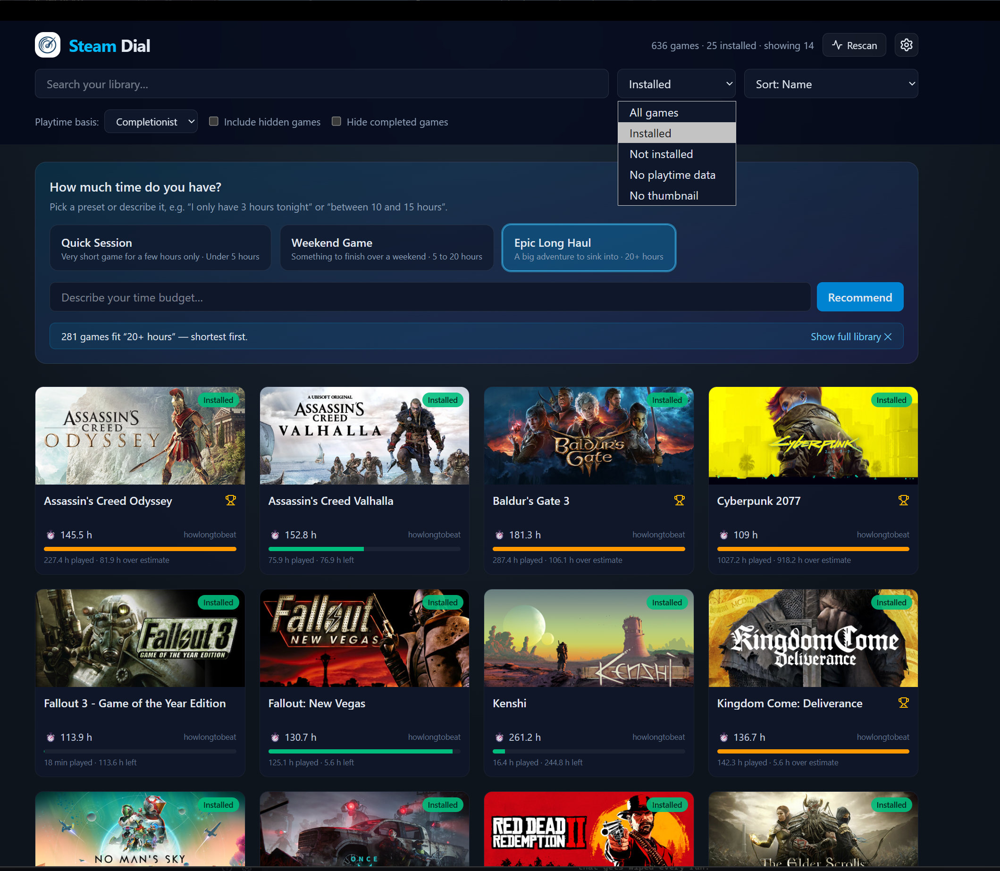

# Steam Dial

How much time do you have?

SteamDial is a local, read-only Steam library browser that recommends what to play next based on how
much time you have, using "time to beat" estimates (e.g. HowLongToBeat).

It can also show you only much your play time compares to the estimated play time of a game.

It runs a small Flask app served either in its own native window (via `pywebview`) or in
a regular browser tab, and never writes to your Steam installation.

## Getting started

Launch Steam Dial (either `python steamdial.py` from source, or `SteamDial.exe` if you're
using the packaged build). On first run it finds your Steam install automatically (via the
Windows registry and the usual install locations), scans your library and opens in its own
window, no setup required — everything below is optional, on top of that default experience.

If your Steam library can't be found, Steam Dial opens **Settings** on startup and asks for
it. See [Pointing Steam Dial at your Steam library](#pointing-steam-dial-at-your-steam-library).

## Pointing Steam Dial at your Steam library

Auto-detection covers the usual setups, including Steam installed on a second drive. When it
comes up empty (an unusual install location, a portable/offline copy of the library), open
**Settings** with the gear icon in the top-right corner and fill in **Steam library folder**:

- Enter the folder Steam is installed in — the one containing `steamapps`, e.g.
  `C:\Program Files (x86)\Steam` or `F:\Steam`. Steam Dial checks the folder when you save
  and tells you if there's no `steamapps` inside it.
- **Detect** searches for a Steam installation and fills the field in for you.
- Leave the field empty to go back to auto-detecting on every start.

Hit **Save**, then restart Steam Dial for the new folder to take effect. The setting is
stored as `STEAMDIAL_STEAM_ROOT` in the `.env` file next to Steam Dial; setting that
environment variable yourself, or passing `--steam-root`, works just as well and takes
priority. Steam Dial only ever reads from this folder — it never writes to your Steam install.

## Setting up API keys

Click the gear icon in the top-right corner to open **Settings**. Two keys are supported,
both optional and both free:

- **Steam Web API key** — lets Steam Dial fetch your real owned-games list and actual
  playtime from Steam directly, instead of guessing from local files. Get one from
  [steamcommunity.com/dev/apikey](https://steamcommunity.com/dev/apikey).
- **SteamGridDB API key** — fills in box art for games that Steam's own servers don't have
  artwork for. Get one from your
  [SteamGridDB account preferences](https://www.steamgriddb.com/profile/preferences/api).

Paste the key(s) in, hit **Save**, then restart Steam Dial for them to take effect.

## Running a scan

Steam Dial scans your library automatically on startup, then right away (and every few
minutes after that) checks the Steam Web API and local files in the background for newly
bought games. When new games
are found, an orange **Scan new games** button appears next to **Rescan**; click it to add
just those games without re-scanning your whole library. Use **Rescan** instead if you've
installed/uninstalled/hidden games and want to refresh the full list — this also re-checks
for new playtime estimates and artwork in the background (shown by the progress bar under
the search bar).

## Adding a game Steam doesn't track

Games you own outside Steam (GOG, itch.io, a disc, an offline install) never show up in a
scan. Click **Add a new game** in the header and type the title — that's all Steam Dial
asks for. The game joins your library straight away, survives rescans and restarts, and
gets a completionist estimate looked up from its title like any other game.

From then on it behaves like a scanned game: use the card's artwork pencil to give it a
thumbnail (nothing can be downloaded for it automatically) and the **Edit game** pencil to
record play time, mark it completed, or hide it. Its card is badged *Added manually* and
has no **Steam** button, since there is no Steam page to open. Added titles are stored in
`data/manual_games.json`.

For added games the **Edit game** panel also gains two things scanned games don't have:

- **Game title** — fix a typo or retitle the game. Its thumbnail and saved hours stay with
  it, and the completionist estimate is looked up again under the new title.
- **Remove game** — delete it from your library after a confirmation, along with its
  thumbnail, overrides and cached estimate. Scanned Steam games can't be renamed or
  removed this way; hide them instead.

## Opening games

Hover over a game card to reveal **Steam** and **HowLongToBeat** buttons over its artwork.
**Steam** opens the game's library page in the Steam client; **HowLongToBeat** opens a
search for the game in your browser. The buttons also appear when tabbing into a card
with the keyboard, and stay visible on touch devices. Clicking elsewhere on a card no
longer opens Steam.

## Fixing missing thumbnails

Hover over any game card and click the small pencil icon on its artwork to open the
thumbnail editor. Pick an image from your computer, pan and zoom it to fit, then save — your
image always takes priority over anything Steam Dial would have found on its own. Use the
**No thumbnail** filter (see below) to quickly find every game still missing artwork.
Saved replacements persist across sorting, filtering, recommendations, rescans, and restarts.
They are stored in `thumbnails/overrides/` beside the script (or executable); replacing an
image updates its URL so the browser does not reuse previously cached artwork.

## Editing a game

Hover over any game card and click the pencil (**Edit game**) icon on its artwork to open the
game editor, where you can:

- **Mark as completed (outside Steam)** — for games you finished but Steam doesn't know about.
  This checkbox is only your own flag: games counted as completed automatically (because their
  play time already covers the completionist estimate) leave it unchecked and say so underneath,
  so lowering the play time again clears the completed mark.
- **Hide this game** — hide a game that isn't hidden in your Steam library.
- **Completionist hours override** — replace a wrong or missing "time to complete" estimate.
- **Play time override (hours)** — manually record how long you've played a game whose time
  Steam never tracked (played on another store or platform, or offline). It replaces Steam's
  own figure everywhere play time is used: the "played" figure and progress bar on each card,
  "time left" sorting, and the automatic "completed" mark. Cards using a manual figure show
  it as *played (manual)*. Leave the field empty to go back to Steam's tracked play time.

Your edits are stored in `data/user_overrides.json` and survive rescans and restarts.

## Sorting and filtering

- **Search** — filter the library by game name.
- **Status dropdown** — show all games, or narrow to Installed, Not installed, Local games
  (added by me), Completed games only, Hidden games only, No completion estimate, or No thumbnail.
  **Local games (added by me)** lists only
  the titles you added yourself (see above), which makes them easy to find again in a large
  library. **Completed games only** and **Hidden games only** are deliberate "show me what's
  normally out of sight" views: each lists its whole category even when *Include hidden games* is
  unticked or *Hide completed games* is ticked. **No completion estimate** lists the games with no "time to complete" figure for the
  current playtime basis; those cards read *Estimate unknown*, which is independent of the play
  time Steam tracked for you — that still shows underneath whenever it isn't zero. **No thumbnail**
  lists only the games whose artwork genuinely can't
  be found anywhere; shortly after startup it may still be settling while Steam Dial finishes
  downloading the artwork it hasn't cached yet.
- **Sort dropdown** — order by Name, Shortest/Longest first, Time left (shortest first), or
  Installed first.
- **Playtime basis dropdown** — switch between Main Story, Main + Extra, and Completionist
  hours; this changes both the hours shown on each card and what "shortest/longest first"
  sorting is based on.
- **Include hidden games** — also show games you've hidden in your Steam library.
- **"How much time do you have?"** — pick a preset (Quick Session, Weekend Game, Epic Long
  Haul), type a time budget in plain language (e.g. "under 4 hours", "a weekend game"), or
  drag the slider to update your recommendations. The slider ranges from less than 1 hour
  through budgets of up to 60 hours, with a final open-ended **More than 60 hours** option.

For install instructions, command-line flags, and a breakdown of the codebase, see
[docs/TECHnICAL_DETAILS.md](docs/TECHNICAL_DETAILS.md).

## DISCLAIMER

Steam Dial was developed to fill a gap in the official Steam client (the absence of filters by average time to play or complete games).

It has been developed with Claude and GitHub Copilot to save time, and has been tested on Windows 11.

This has no affiliation to Steam or Valve, and is in no way an official product.

It is subject to break any time Valve makes a significant change to the Steam Desktop client.
